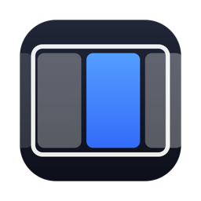

<p align="center"></p>

<h1 align="center">Roller</h1>

<p align="center">A scrolling window manager for macOS. Your windows sit side by side on an endless horizontal strip, and opening a new one never squeezes the others.</p>

---

Tiling window managers fit every window into the screen, so each new app shrinks the rest. Roller works the way [PaperWM](https://github.com/paperwm/PaperWM) and [niri](https://github.com/YaLTeR/niri) do on Linux: windows are columns on a strip that runs past the edges of the display. A new window opens next to the focused one, nothing else changes size, and you scroll the strip with the keyboard or a trackpad swipe.

Roller is a native Swift app that lives in the menu bar. It needs only the Accessibility permission: no SIP changes, no Screen Recording, no Input Monitoring, no account and no telemetry.

## Features

- **Endless strip.** Every window is a column. There's one strip per display and per macOS Space.
- **Spring animation.** Motion uses a damped spring driven by the display's refresh rate. Shortcuts act the moment you press them.
- **Stacks.** You can put several windows in one column, pull windows in from either side, pop them back out either way, reorder inside a stack, and change heights.
- **Tabbed columns.** A stack can show its windows as tabs: each one gets the full column height and a tab bar shows what's inside.
- **Widths.** Cycle through preset widths, make a column wider or narrower, toggle full width, or center the focused column. A width you set with the mouse stays.
- **Centering modes.** `never`, `on-overflow` or `always`.
- **Gaps and Dock-aware sizing.** Separate gaps between windows and at the screen edges. Windows leave room for the Dock.
- **Minimap.** A small map of the strip appears while you navigate.
- **Trackpad swipe.** A 3-, 4- or 5-finger swipe moves the strip with your fingers and settles on the nearest column.
- **Drag to reorder.** Drop a window onto another column to move it there, or onto another display.
- **Multiple displays.** Each display gets its own strip, with "send to next display".
- **Display profiles.** Choose when Roller manages the built-in screen and when it manages external displays: always, only while that display is the only one connected, or never. For example, it can run on your MacBook's screen on the go and step aside the moment you plug in a monitor. Per-display overrides cover the exceptions, and a notice shows when a display change switches Roller on or off.
- **Pausing.** Shortcuts, the swipe and focus follows mouse pause while chosen apps are in front, such as games, VMs or remote desktops. They can also free up while no display is managed.
- **Power aware.** Roller follows macOS Reduce motion, and can optionally turn animation off on battery or in Low Power Mode.
- **Session restore.** Column order, widths, stacks and tabs survive a restart.
- **Window rules.** Match a bundle ID and/or a title regex, then float the window or give it a fixed place on the strip. Fixed-size windows such as Calculator, dialogs and Roller's own windows float automatically.
- **Optional extras.** A focus border, dimming of inactive windows, focus follows mouse, mouse follows focus, and focus that wraps around at the ends of the strip. All are off by default. You can also choose where new windows open (next to the focused one, at the end or at the start), where the minimap sits and how long it stays, and hide the menu bar icon.
- **No focus stealing.** A background app that opens a window doesn't take focus or scroll the strip.
- **Native full screen is left alone.**
- **Automation.** A `roller://` URL scheme, a `roller` CLI and Raycast script commands.
- **Settings window.** Every setting applies instantly and is saved to a TOML file you can also edit by hand.
- **Mac Setup.** Checks the macOS settings that matter (trackpad gestures, Spaces, Stage Manager, macOS tiling) and flags other window managers that are running.
- **Self-healing.** An engine log, a periodic check that recovers missed windows, and a Restart command.
- **Update checks.** A daily check for new GitHub releases, which you can turn off.

## Install

### Download

Get the latest `Roller-x.y.z.dmg` from [Releases](https://github.com/current/roller/releases) and drag Roller into **Applications**. Release builds aren't notarized, so the first time you open Roller, right-click it and choose **Open**, or run:

```bash
xattr -dr com.apple.quarantine /Applications/Roller.app
```

### Build from source

You need Xcode 15 or later (or its command line tools) on macOS 13 Ventura or later.

```bash
git clone https://github.com/current/roller.git && cd roller
make install
```

`make install` builds `build/Roller.app` and copies it to `/Applications`. Other targets: `make test`, `make app`, `make universal` (Apple silicon + Intel), `make dmg`.

### First run

1. Open Roller from Applications. Run it from there and not from a disk image, because macOS ties the Accessibility permission to the app's location.
2. Allow **Accessibility** when asked (System Settings › Privacy & Security › Accessibility).
3. Open **Mac Setup** from the menu bar icon and fix anything shown in orange. The most important item is the trackpad: macOS must not use the same swipe to switch desktops. The recommended setup is to turn off *Swipe between full-screen applications* and keep Roller on 4 fingers.

> **Tip:** If Roller says it has no permission even though the switch is on (this happens after rebuilding or moving the app), remove Roller from the Accessibility list with **–**, add it again with **+**, then choose **Restart** from the menu bar menu.

## Default shortcuts

Every default uses ⌃⌥ (Control-Option). Plain ⌥ stays free for typing characters like ç and for jumping by word. All shortcuts can be changed on the Shortcuts page, and one action can have several. Shortcuts follow physical keys and are shown with your layout's characters, so AZERTY, QWERTZ and Dvorak work.

| Action | Shortcut |
|---|---|
| Focus left / down / up / right | ⌃⌥H / J / K / L, or ⌃⌥ + arrow keys |
| Focus the first / last window | ⌃⌥⌘← / ⌃⌥⌘→ |
| Focus place 1–8, 9 = last | ⌃⌥1 … ⌃⌥9 |
| Move the focused window to place 1–8, 9 = last | ⌃⌥⇧1 … ⌃⌥⇧9 |
| Move the window left / down / up / right | ⌃⌥⇧H / J / K / L, or ⌃⌥⇧ + arrow keys |
| Move to the first / last spot | ⌃⌥⌘⇧← / ⌃⌥⌘⇧→ |
| Cycle preset widths | ⌃⌥R |
| Full width | ⌃⌥F |
| Center column | ⌃⌥C |
| Wider / narrower | ⌃⌥= / ⌃⌥- |
| Taller / shorter (in a stack) | ⌃⌥⇧= / ⌃⌥⇧- |
| Equalize heights | ⌃⌥0 |
| Stack into the left column | ⌃⌥] |
| Stack into the right column | ⌃⌥[ |
| Pop out of the stack (right / left) | ⌃⌥⇧] / ⌃⌥⇧[ |
| Tabbed column | ⌃⌥⇧T |
| Float / unfloat | ⌃⌥T |
| Send the window to the next display | ⌃⌥N |
| Stop / start Roller | ⌃⌥Q |
| Scroll the strip | 4-finger swipe left or right on the trackpad |

## Displays

The **Displays** page has quick setups for the common cases:

| Quick setup | Built-in screen | External displays |
|---|---|---|
| Everywhere | always | always |
| Laptop on the go | only when no monitor is connected | never |
| Monitors when docked | only when no monitor is connected | always |
| External displays only | never | always |
| Built-in screen only | always | never |

Roller re-checks the profile whenever a display is connected or disconnected. On a display it stops managing, hidden windows come back into view and stay where they are. The strip's layout is remembered and returns when the display is managed again. A per-display override (always on / always off) wins over the profile. Overrides are remembered by display ID, so they come back when you reconnect that display.

## Configuration

The settings window covers everything. It writes `~/.roller.toml`, and Roller also reads `$XDG_CONFIG_HOME/roller/roller.toml` or `~/.config/roller/roller.toml` if one of those exists. Edits you make to the file are picked up live. Choose **Open Configuration** in the menu bar menu to find it.

```toml
[options]
preset_column_widths = [0.25, 0.33, 0.5, 0.66, 0.75]  # fractions of the screen
default_column_width = 0.0       # 0 = new windows keep their own width
gap_inner = 8.0                  # between windows, 0-64 points
gap_outer = 8.0                  # at the screen edges, 0-64 points
center_focused_column = "never"  # never | on-overflow | always
dock_aware = true
width_step = 0.1
height_step = 0.1
new_window_position = "next"     # next | end | start
wrap_focus = false               # focus wraps around at the ends
focus_border = false
focus_border_width = 3.0
focus_border_color = "#3D8BFDFF" # #RRGGBB or #RRGGBBAA
focus_border_radius = 10.0
dim_inactive = false
dim_inactive_opacity = 0.25
minimap = true
minimap_position = "top"         # top | bottom
minimap_duration_ms = 1100.0
tab_bar_height = 26.0
animation_duration_ms = 500.0    # 0 turns animation off
animation_damping = 0.9          # 1.0 = no overshoot, lower bounces
respect_reduce_motion = true     # follow macOS Reduce motion
reduce_motion_on_battery = false # no animation on battery / Low Power Mode
focus_follows_mouse = false
mouse_follows_focus = false
swipe_gesture_fingers = 4        # 3, 4, 5 or 0 = off
swipe_natural = true
swipe_sensitivity = 1.0
drag_to_reorder = true
launch_at_login = false
check_for_updates = true
show_menu_bar_icon = true
builtin_display = "always"       # always | alone (only when no other display) | never
external_displays = "always"     # always | alone (lid closed) | never
display_overrides = {}           # { "<display UUID>" = "on" | "off" }
notify_display_changes = true
release_input_when_idle = true   # free shortcuts and swipe when no display is managed
pause_for_apps = []              # bundle IDs, e.g. ["com.parallels.desktop.console"]

[bindings]
focus_left = ["ctrl+alt+h", "ctrl+alt+left"]
cycle_width = ["ctrl+alt+r"]
# … every action; an empty list unbinds it

[windows.pip]
title = "Picture.*(in)?.*[Pp]icture"
floating = true

[windows.terminal]
bundle_id = "com.apple.Terminal"
floating = false
slot = 1                         # new Terminal windows open at place 1
```

Shortcut syntax is `ctrl`, `alt`, `shift` and `cmd`, joined with `+`, followed by a key: a letter, a digit, `left`/`right`/`up`/`down`, `equal`, `minus`, `leftbracket`, `rightbracket`, `f1`…`f20` and so on. Symbols like `⌃⌥←` also work.

## Automation

Every action has a name, such as `focus_left`, `cycle_width`, `stack_into_left` or `toggle_float`. The Shortcuts page lists them all.

```bash
open -g roller://focus_left
```

The CLI ships inside the app:

```bash
ln -sf /Applications/Roller.app/Contents/Resources/bin/roller /usr/local/bin/roller
roller cycle_width
roller list      # every strip as JSON
roller status
```

The [`raycast`](raycast) folder has Raycast script commands. In Raycast, open Settings › Extensions › Script Commands › Add Directories and add that folder.

## How it works

- **Windows:** Roller watches each app through the Accessibility API (`AXObserver`) for windows that appear, close, move, resize, minimize or change focus. It moves windows with `AXUIElementSetAttributeValue` on a background queue that always sends a window its newest frame and drops stale ones, so a slow app never holds up the animation.
- **Layout:** The strip model, layout geometry, scrolling, snapping and spring are pure Swift in `Sources/RollerCore`, with unit tests.
- **Hidden windows:** macOS never lets a window leave the screen completely, so windows that are scrolled out of view are parked in a bottom corner with a one-point sliver showing. Setting the screen-edge gap to 0 tucks it behind your windows. Toward a display placed side by side, a window can only slide halfway off before it hides; otherwise macOS would move it onto that display. Arranging displays above or below each other avoids this.
- **Shortcuts:** These use Carbon `RegisterEventHotKey`, which needs no Input Monitoring permission.
- **Trackpad:** A listen-only event tap reads finger positions from gesture events. It never blocks them, which is why macOS mustn't use the same swipe for itself.
- **Spaces and focus:** Roller uses a few read-only window server calls to tell which Space a window is on, and to focus exactly one window without raising the rest of its app. It loads them at runtime and needs no SIP changes.

## Project layout

```
Sources/RollerCore     strip model, layout, spring, config + TOML, actions, IPC types
Sources/RollerApp      menu bar app: engine, Accessibility, animation, hotkeys,
                       gestures, overlays, settings UI, Mac Setup, CLI server
Sources/roller         the command line client
Tests/RollerCoreTests  unit tests
scripts/               bundle.sh (app + dmg), make-icon.swift
raycast/               Raycast script commands
```

## Limitations

- Window motion goes through the Accessibility API. Most apps move smoothly, but a few redraw slowly while they're animated.
- Apple draws the windows, so compositor effects such as blur, shaders or rounded clipping aren't possible.
- Space switching belongs to macOS. Each Space has its own strip; use Mission Control or ⌃← / ⌃→ to change Spaces.

## License

[MIT](LICENSE)
